# Fionix

**Fionix** — современный лаунчер Minecraft с аккаунтами, магазином модов и
сборок, кастомизацией и 3D-просмотром скинов.

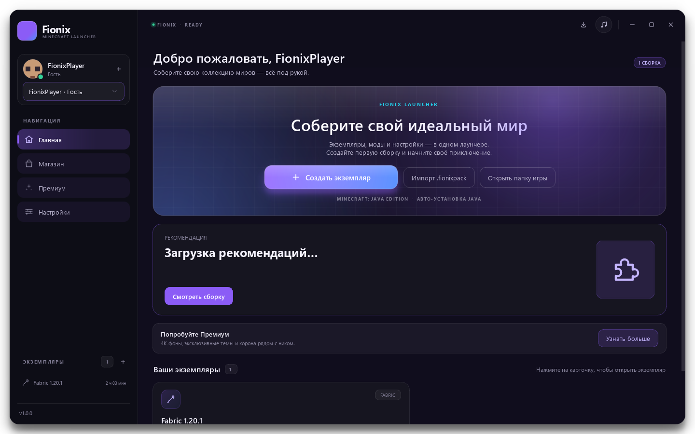

## Возможности

### Аккаунты и профиль

- Microsoft, LittleSkin, Ely.by и гостевой профиль.
- Несколько аккаунтов, быстрое переключение в сайдбаре.
- Профиль открывается по клику на аватар: выбор аккаунта, загрузка PNG-скина,
  моментальное обновление аватарки и 3D-модели.
- Скины LittleSkin/Ely.by загружаются автоматически.
- 3D-просмотрщик показывает базовый и внешний слой одежды/шляпы с анимацией
  ходьбы.

### Магазин

- Отдельная вкладка **«Магазин»**: поиск и каталог сборок Modrinth и CurseForge.
- Карточки с иконкой, автором, числом скачиваний и версией игры.
- Подробное описание сборки: ядро, версия Minecraft и список модов.
- Установка создаёт новый экземпляр и скачивает все моды сборки.
- Внутри экземпляра — «Моды / Текстурпаки / Шейдеры / Карты».
- Маркет модов: поиск Modrinth, популярные моды без пустого экрана, полное
  описание, установка в фоне с индикатором на карточке и зависимостями.
- CurseForge работает по ключу из `config.py`; без ключа вкладка временно
  недоступна, а Modrinth продолжает работать.

### Сборки

- Экспорт и импорт `.fionixpack`.
- Импорт создаёт изолированный экземпляр и последовательно скачивает моды.
- Кнопка **«Поделиться»** на странице экземпляра.

### Кастомизация

- Видео-фон на `QGraphicsView` + `QGraphicsVideoItem` с плавным переключением.
- Акцентный цвет.
- Настройка цвета текста и панелей.
- Авто-контраст для светлых фонов.
- Кроппер фонового изображения: перетаскивание и масштабирование.
- Фон-картинка или MP4-видео.
- Бесплатно — до 10 МБ; Премиум снимает лимит и открывает 4K-фоны.
- **F11** — полноэкранный режим без скруглений.

### Ядра и оптимизация

- Vanilla, Forge, NeoForge, Fabric, Quilt и OptiFine.
- Чекбокс оптимизации при создании:
  - Fabric: Sodium + Lithium + FerriteCore;
  - Forge: Embeddium + Oculus;
  - без галочки ничего не скачивается.

### Загрузки и Премиум

- Иконка «Загрузки» в правом верхнем углу показывает активные моды и сборки,
  прогресс и скорость скачивания.
- Отдельная вкладка «Премиум» с преимуществами, активацией и короной у ника.
- На главной — баннер «Попробуйте Премиум».

### Ошибки и музыка

- Crash-диалог с логом и кнопкой «Спросить у ИИ».
- Предупреждение при RAM меньше 2 ГБ.
- Встроенный музыкальный плеер с плейлистом и повтором.

### Системная логика

- При запуске Minecraft окно скрывается, лаунчер остаётся в системном трее,
  время игры считает фоновый таймер.
- После закрытия игры окно возвращается.
- Кнопка «Удалить экземпляр» с подтверждением полностью удаляет папку сборки.

## Скриншоты

| Главная | Экземпляр |
| --- | --- |
|  | 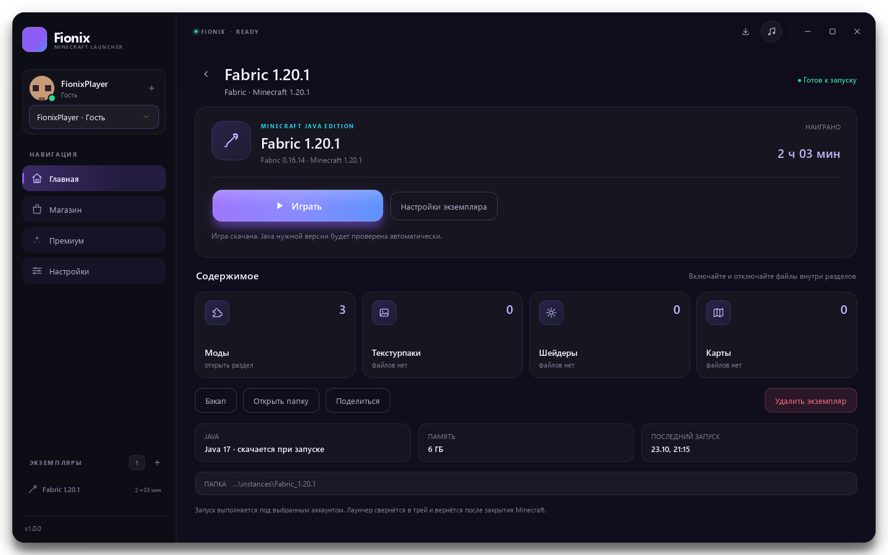 |

| Создание сборки | Профиль |
| --- | --- |
| 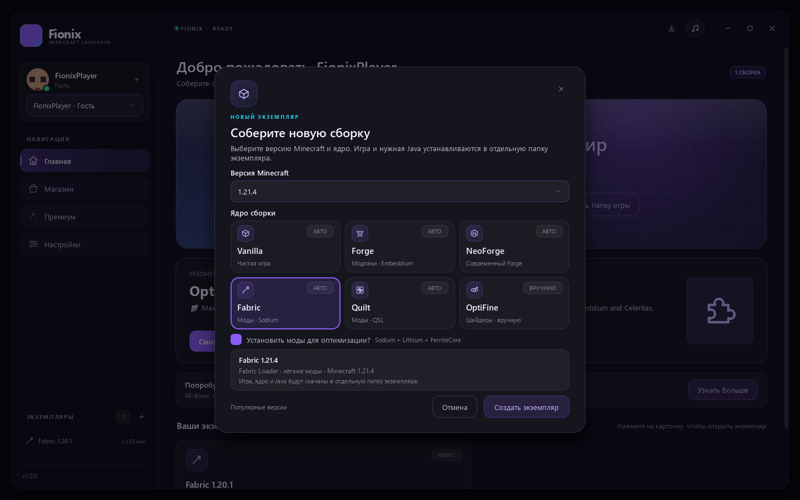 | 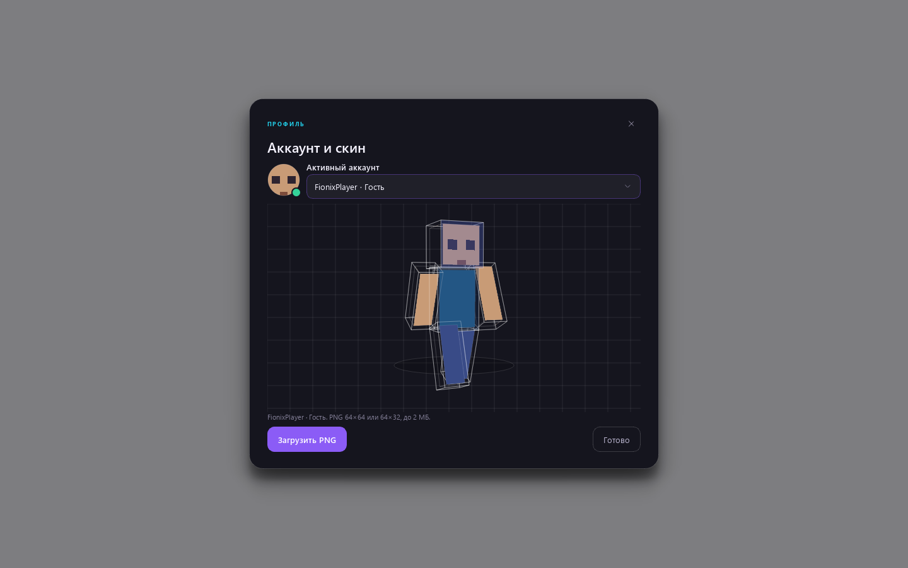 |

| Магазин сборок | Маркет модов |
| --- | --- |
| 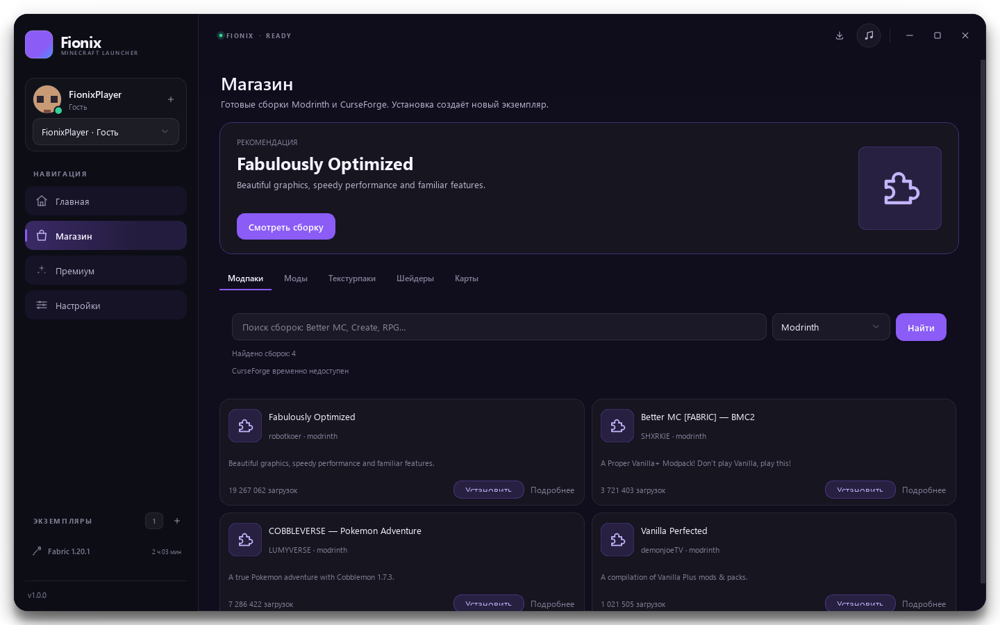 | 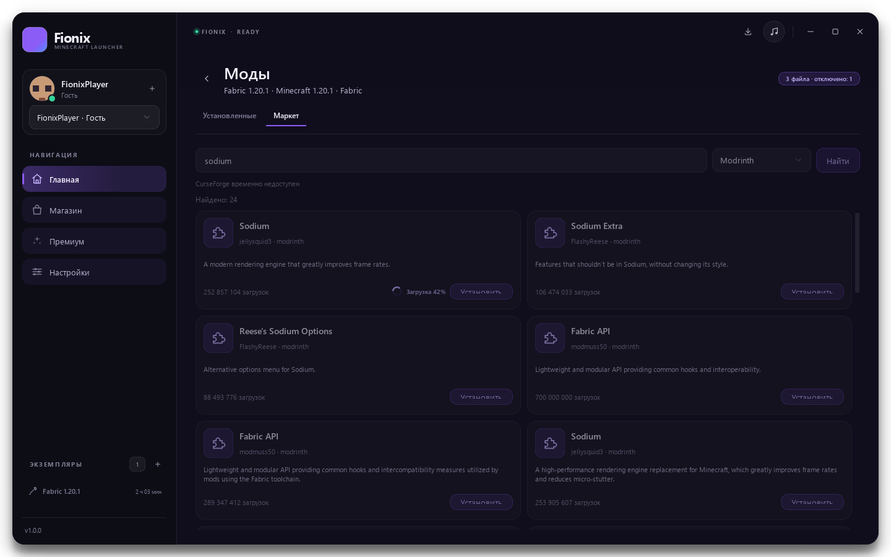 |

| 3D-скин | Моды экземпляра |
| --- | --- |
| 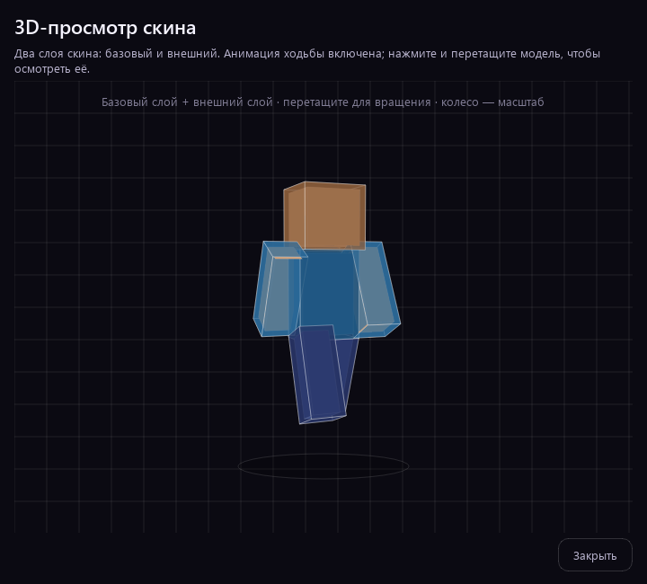 | 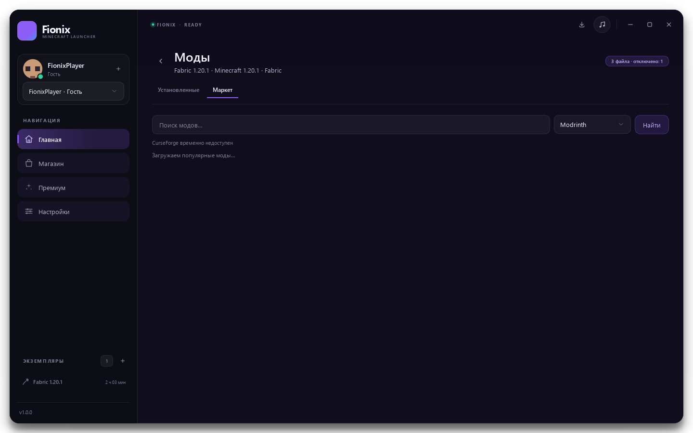 |

| Настройки | Плеер |
| --- | --- |
| 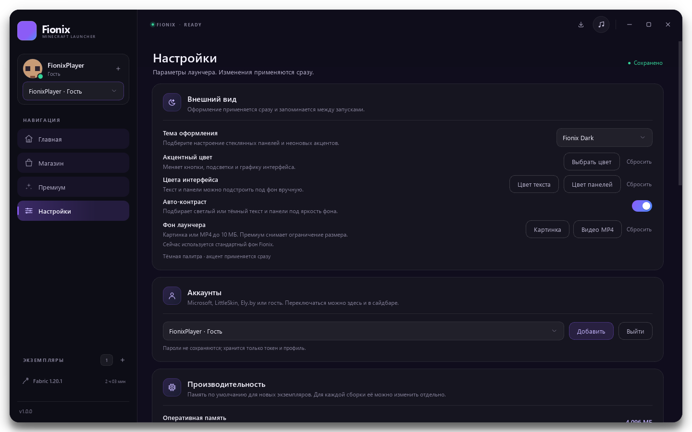 | 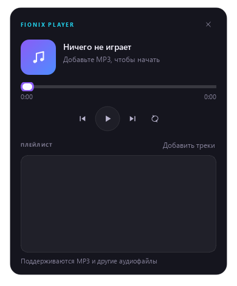 |

| Crash-диалог |
| --- |
| 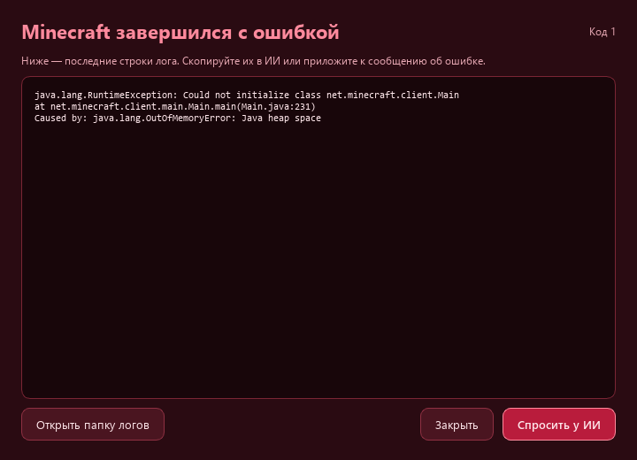 |

## Требования

- Windows 10/11
- Python 3.11+ для запуска из исходников
- Интернет для аккаунтов, магазина и загрузки игры
- Около 0.5–1 ГБ на один экземпляр
