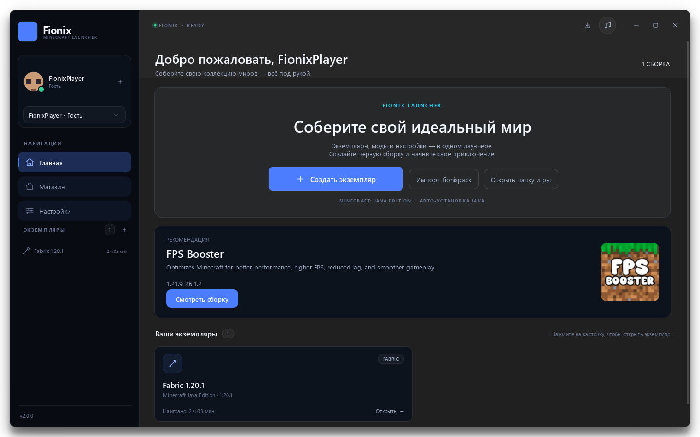
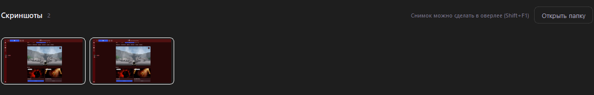

<div align="center">


**Fionix 2.0** — лаунчер Minecraft для Windows: аккаунты, магазин модов и сборок,
игровой оверлей, скриншоты, кастомизация и просмотр скинов.

</div>


## Возможности

### Аккаунты и профиль

- Microsoft, LittleSkin, Ely.by и гостевой профиль.
- Несколько аккаунтов, быстрое переключение в сайдбаре.
- Профиль открывается по клику на аватар: выбор аккаунта, загрузка PNG-скина,
  моментальное обновление аватарки и превью.
- Индикатор срока действия токена Microsoft с обновлением в один клик.
- Выбор плащей Microsoft прямо в профиле.

### Скины и плащи

- Просмотр скина — **предрендер**: готовые ракурсы (спереди, 3/4, слева, сзади,
  справа, сверху, снизу) рисуются один раз при загрузке скина и кэшируются.
  Никакого WebGL в реальном времени, поэтому вращение не лагает.
- Кнопки «Влево / Вправо / Вверх / Вниз» и «Сброс»; направления совпадают
  с тем, что видно на модели.
- Плащ рисуется собственной текстурой (`textures.minecraft.net`) со наклоном,
  как в игре; поддержаны форматы 64×32, 22×17 и HD.

### Игровой оверлей

- `Shift+F1` — показать/скрыть оверлей поверх Minecraft (панели «Браузер»,
  «Музыка», «Игра»).
- Игра уходит в фон, мышь и клавиатура принадлежат оверлею; при скрытии фокус
  возвращается в игру.
- Оверлей закрывается сам, если переключиться в другое окно, — он не висит
  поверх браузера или проводника.
- Панели перетаскиваются и растягиваются, позиции сохраняются.
- Музыка общая с лаунчером: один `QMediaPlayer` на всё приложение.

### Скриншоты

- Кнопка «Сделать скриншот» в оверлее сохраняет снимок в
  `instances/<сборка>/screenshots/`.
- Галерея на странице экземпляра показывает и снимки оверлея, и **F2-снимки
  самого Minecraft** — у каждой сборки своя папка.

### Магазин

- Отдельная вкладка **«Магазин»**: поиск и каталог сборок Modrinth и CurseForge.
- Карточки с иконкой, автором, числом скачиваний и версией игры.
- Подробное описание сборки: ядро, версия Minecraft и список модов.
- Установка создаёт новый экземпляр и скачивает все моды сборки.
- Внутри экземпляра — «Моды / Текстурпаки / Шейдеры / Карты».
- Маркет модов: поиск Modrinth, популярные моды без пустого экрана, полное
  описание, установка в фоне с индикатором на карточке и зависимостями.
- CurseForge работает через собственный прокси-воркер, адрес задаётся в
  `config.py`; без него вкладка отключается, а Modrinth продолжает работать.

### Сборки

- Экспорт и импорт `.fionixpack`.
- Импорт создаёт изолированный экземпляр и последовательно скачивает моды.
- Кнопка **«Поделиться»** на странице экземпляра.

### Кастомизация

- Три темы (Dark / Midnight / Light), акцентный цвет, цвет текста и панелей.
- Авто-контраст для светлых фонов.
- Фон — картинка (с кроппером) или MP4-видео до 10 МБ.
- **F11** — полноэкранный режим без скруглений.

### Ядра и оптимизация

- Vanilla, Forge, NeoForge, Fabric, Quilt и OptiFine.
- OptiFine скачивает официальный установщик и запускает его через Java.
- Все версии Mojang: Release, Snapshot, Old Beta и Old Alpha.
- Переключатель «Показывать снапшоты и старые версии» в настройках.
- Чекбокс оптимизации при создании:
  - Fabric: Sodium + Lithium + FerriteCore;
  - Forge: Embeddium + Oculus;
  - без галочки ничего не скачивается.

### Загрузки, ошибки, музыка

- Иконка «Загрузки» в правом верхнем углу: активные моды и сборки, прогресс,
  скорость.
- Установка версий, модпаков и импорт `.fionixpack` выполняются в фоне.
- Crash-диалог с логом и кнопкой «Спросить у ИИ».
- Предупреждение при RAM меньше 2 ГБ.
- Встроенный музыкальный плеер с плейлистом, перемешиванием и повтором.

### Системная логика

- При запуске Minecraft окно скрывается, лаунчер остаётся в трее, время игры
  считает фоновый таймер.
- После закрытия игры окно возвращается.
- Кнопка «Удалить экземпляр» с подтверждением полностью удаляет папку сборки.

## Скриншоты

| Главная | Экземпляр |
| --- | --- |
|  |  |

| Создание сборки | Профиль |
| --- | --- |
|  |  |

| Магазин сборок | Маркет модов |
| --- | --- |
|  |  |

| Скин (предрендер) | Моды экземпляра |
| --- | --- |
|  |  |

| Настройки | Плеер |
| --- | --- |
|  |  |

| Crash-диалог | Тёмная тема (Midnight) |
| --- | --- |
|  |  |

| Галерея скриншотов экземпляра |
| --- |
|  |

## Установка

1. Скачайте `Fionix_Setup.exe` из раздела **Releases** и запустите его.
   Права администратора не нужны: лаунчер ставится в
   `%LOCALAPPDATA%\Programs\Fionix`, ярлык появляется на рабочем столе.
2. Либо запустите портативный `Fionix.exe` из любой папки.
3. Данные и настройки хранятся в `%APPDATA%\Fionix`.

## Сборка из исходников

```powershell
python -m venv .venv
.\.venv\Scripts\activate
python -m pip install -r requirements.txt
python main.py                  # запуск из исходников

python -m pip install pyinstaller
pyinstaller Fionix.spec         # dist\Fionix.exe
pyinstaller Fionix_Setup.spec   # установщик (нужен release-onefile\Fionix.exe)
```

Проверки:

```powershell
python -m unittest discover -s tests -v
python tools/smoke_test.py
```

## Требования

- Windows 10/11, Python 3.11+ для запуска из исходников.
- Интернет для аккаунтов, магазина и загрузки игры.
- Около 0.5–1 ГБ на один экземпляр.

## Документация

- [INSTRUCTIONS.md](INSTRUCTIONS.md) — OAuth, CurseForge-воркер, сборка, обновления.
- [CHANGELOG.md](CHANGELOG.md) — что изменилось в 2.0.

## Лицензия

[MIT](LICENSE).
